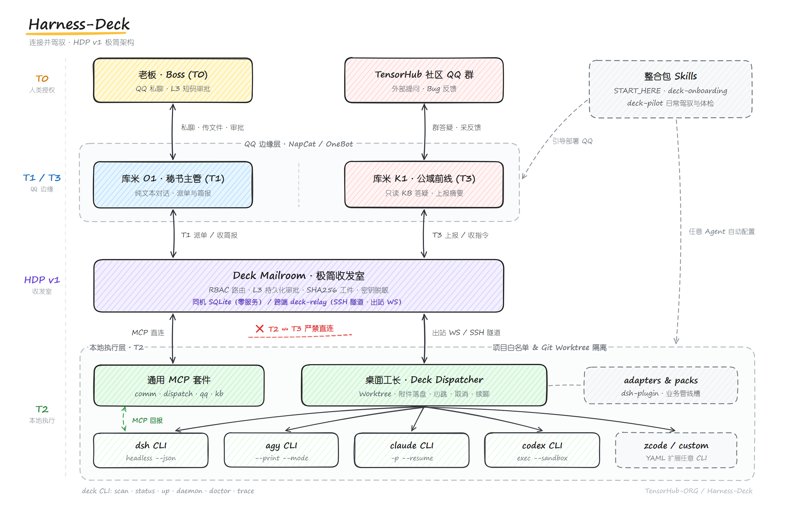

# Harness-Deck

> **Harness-Deck — 连接并驾驭。 / Harness-Deck - Connect and harness.**
>
> 以人为核心驾驭主体（Human-in-the-Loop）的多 Agent 分层协作开放协议（HDP v1）与「多 Skill + 多 MCP + 0 基础交互式引导」整合包。
> 面向 [TensorHub-ORG](https://github.com/TensorHub-ORG) 开源项目自动化维护体系（Coomi、Qmmi、Latexsnipper、Storydex 等），同时保持完全工具中立。

---

## 系统架构



> 矢量高清源图：[`docs/architecture.svg`](docs/architecture.svg) · 高清成图（3200×2160）：[`docs/architecture.png`](docs/architecture.png)

---

## 核心特性

- **任意 Agent 解包即用**：把本仓库交给任意你正在使用的 Agent（`dsh`、Claude Code、Codex、Antigravity、ZCode、Coomi、Cursor 等），让它阅读 [`START_HERE.md`](START_HERE.md)，即可像向导一样分步问询你的部署方式（本地 / 远程 SSH 服务器）、权限与仓库白名单，并自动完成安装与验收。
- **清晰的四级信任与隔离体系（`T0 > T1 > T2 > T3`）**：
  - `T0` **老板（Boss）**：QQ 私聊 / 真实使用中的任意 Agent，握有最高决策与 L3 高危短码审批权。
  - `T1` **秘书主管（库米 O1）**：承上启下，汇报老板、派单给桌面工程师、指挥下属社区前线。
  - `T2` **内网执行者（桌面工程师 CLI & 管线）**：纳管 `dsh` / `claude` / `codex` / `agy` / `zcode` / `coomi` 及自定义 CLI，强制 `git worktree` 隔离保护主工作区。
  - `T3` **公域前线（库米 K1）**：驻守社区 QQ 群，查只读知识库答疑、结构化采集反馈单向上报 `T1`，与 `T0`/`T2` 硬隔离防 Prompt Injection。
- **极简双模传输（无重型中台）**：
  - **同机零服务模式**：本地 `node:sqlite` + 共享目录，无需启动任何后台服务。
  - **跨端中继模式**：云服务器起一个轻量 `deck-relay`（HTTP + WebSocket），桌面端主动出站连接，免公网 IP / 内网穿透。
- **开箱即用的 10 项工程安全防护**：Git Worktree 隔离、3 档无头沙箱、Windows/POSIX 进程树超时清理、电脑离线队列 + TTL + 幂等键、QQ 防风控节流与超长转文件、Secret Scrubber 密钥脱敏、防死循环 `max_hops` 熔断、`trace_id` 全链路审计、记忆三分区、3 人并行 Mock 替身。

---

## 3 分钟快速上手

### 方式一（推荐）：交给任意 Agent 交互式从 0 部署
直接把本目录交给你的 AI Agent 并发送：

> **“请阅读 `START_HERE.md`，按照里面的交互式引导流程帮我从 0 配置和部署 Harness-Deck。”**

### 方式二：开发者手动构建与全链路自检

```bash
# 需要 Node.js >= 22.5 与 pnpm
pnpm install
pnpm build
pnpm test

# 体检本机已安装的桌面 Agent CLI（dsh / claude / codex / agy / zcode / coomi）
pnpm deck scan

# 初始化本地收发室、密钥、角色配置与示例工作站配置
pnpm deck init --mode local

# 运行全链路端到端自检（包含 RBAC 硬拦截验证、密钥脱敏验证、Mock 工程师全流程闭环）
pnpm deck doctor
```

### 方式三：打包成便携整合包分发给团队或任意机器

```bash
pnpm pack:bundle
# 产物输出至 dist-bundle/harness-deck/，拷贝到任意机器即可由任意 Agent 解包使用
```

---

## 文档导航

- 🧭 Agent 引导入口：[`START_HERE.md`](START_HERE.md)
- 🏗️ 完整架构蓝图：[`docs/BLUEPRINT.md`](docs/BLUEPRINT.md)
- 📜 HDP v1 协议规范与安全模型：[`docs/PROTOCOL.md`](docs/PROTOCOL.md)
- 🤝 团队 0 基础协作开发指南：[`docs/CONTRIBUTING_ZERO_TO_ONE.md`](docs/CONTRIBUTING_ZERO_TO_ONE.md)
