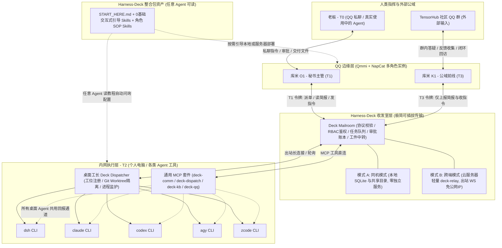
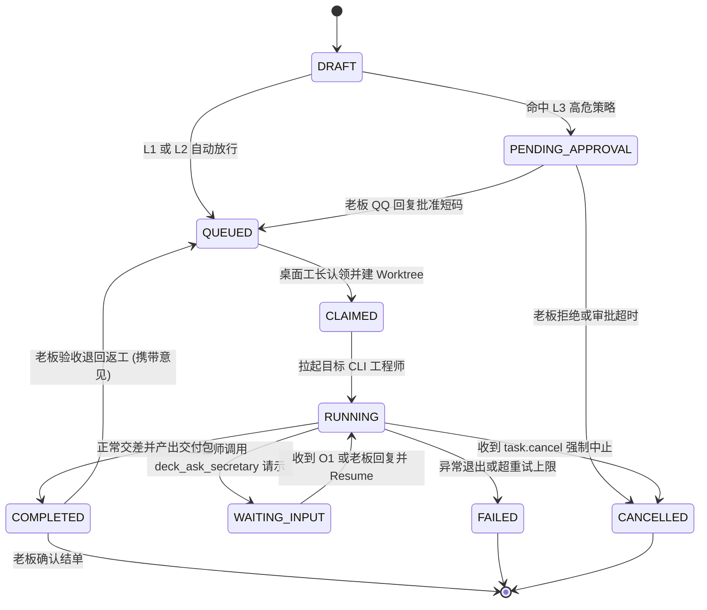
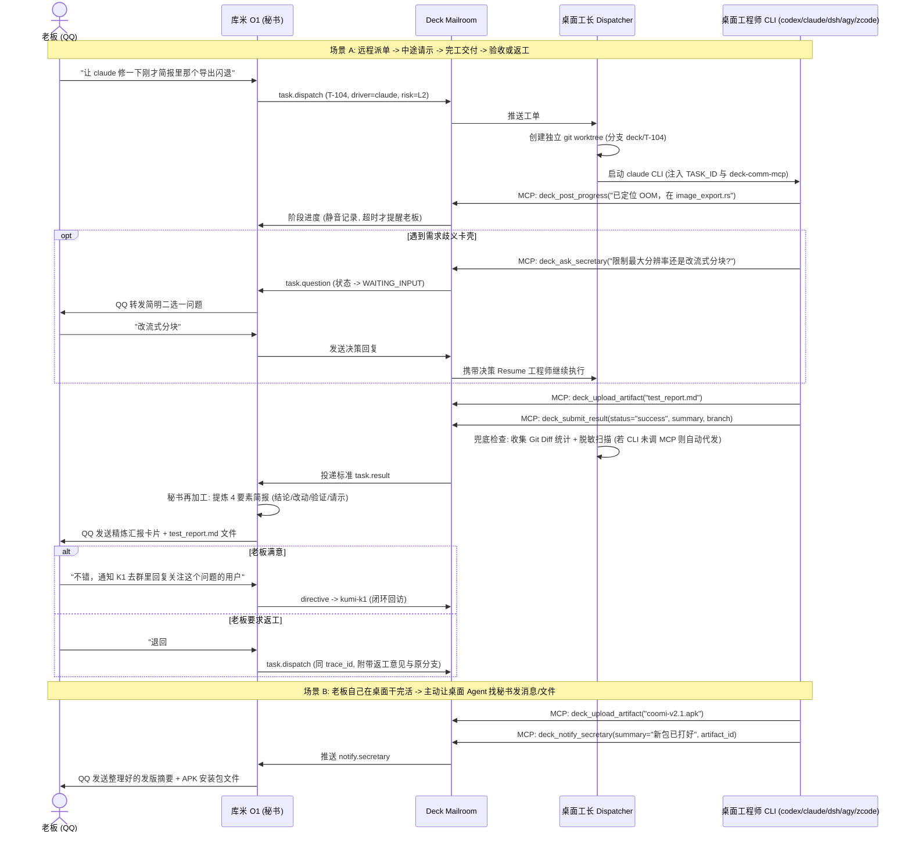
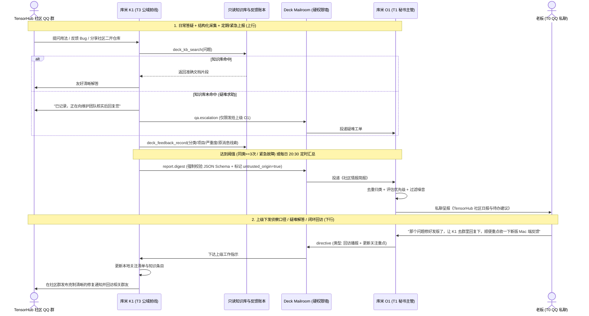

# Harness-Deck 完整系统架构与协议设计蓝图（v1.0）

> **一句话定位**：**Harness-Deck** 是一套**以人为核心驾驭主体、面向多 Agent 分层协作的开放协议（HDP）与「多 Skill + 多 MCP + 0 基础交互式引导」整合包**。
> **适配策略**：协议完全工具中立，任何支持 Skill / MCP 的 Agent 工具（`dsh`、`claude`、`codex`、`agy`、`zcode`、`coomi` 等）都可直接解包读取教程并接入同一协作网络；**DeepSeek Harness（`dsh`）仅作为首个深度适配的参考工具**，不构成使用前提。
> **当前边界**：聚焦**协议规范、整合包结构、场景一（Qmmi + NapCat 双向联动）与场景二（O1/K1 上下级协同 + 桌面工程师集群调度）**；聚合 API 平台（场景三）本阶段暂缓实现，仅在协议层预留扩展位。

---

## 目录

1. [核心概念模型：虚拟研发组织与信任层级（T0 → T3）](#1-核心概念模型虚拟研发组织与信任层级t0--t3)
2. [总体架构：协议优先、传输可插拔](#2-总体架构协议优先传输可插拔)
3. [Harness-Deck 核心协议规范（HDP v1）](#3-harness-deck-核心协议规范hdp-v1)
4. [核心链路一：秘书 O1 如何调度多款桌面 Agent CLI 工程师](#4-核心链路一秘书-o1-如何调度多款桌面-agent-cli-工程师)
5. [核心链路二：桌面 Agent 完工后如何与秘书交互（双向闭环）](#5-核心链路二桌面-agent-完工后如何与秘书交互双向闭环)
6. [核心链路三：库米 K1 与库米 O1 如何上下级协同办公](#6-核心链路三库米-k1-与库米-o1-如何上下级协同办公)
7. [核心链路四：整合包组成与 0 基础交互式引导配置体系](#7-核心链路四整合包组成与-0-基础交互式引导配置体系)
8. [关键工程隐患清单与防御设计（易遗漏的 10 个实战坑）](#8-关键工程隐患清单与防御设计易遗漏的-10-个实战坑)
9. [仓库结构与工具适配策略（以 dsh 为首个适配参考）](#9-仓库结构与工具适配策略以-dsh-为首个适配参考)
10. [分阶段构建路线与三位主力并行认领方案](#10-分阶段构建路线与三位主力并行认领方案)

---

## 1. 核心概念模型：虚拟研发组织与信任层级（T0 → T3）

`Harness-Deck` 不把世界抽象成“某一个重型软件产品”，而是抽象成一家**边界清晰、权责分明的虚拟研发公司**。任何具体工具只要遵守协议，就可以扮演其中的某个岗位。

**信任层级排序原则（仅 4 级，数字越小权限越高、离公域风险越远，类似操作系统 Ring 0~3）**：
> **`T0（老板） > T1（秘书主管） > T2（内网执行者） > T3（公域前线）`**
> - 向下指挥：`T0` 指挥 `T1`，`T1` 统筹派单给 `T2` 并下达工作指示给 `T3`。
> - 水平隔离：**`T2`（内网代码/环境执行）与 `T3`（暴露在公域群聊的前线）严禁直接互通**，中间强制由 `T1` 做审查隔离阀。
> - 社区群外部用户不属于系统内部角色，不单独占层级，统一视为“外部不可信输入”。

| 信任层级 | 组织角色 | 代表实例 | 汇报关系 | 核心职责 | 严禁越界行为 |
| :--- | :--- | :--- | :--- | :--- | :--- |
| **`T0`** | **老板（Boss）** | 核心维护者（QQ 私聊 / 真实使用中的 Agent） | 最高决策者 | 提出目标、审阅简报、审批 L3 高危动作、决定验收或返工 | — |
| **`T1`** | **秘书主管（Secretary）** | **库米 O1**（基于 Qmmi + NapCat） | 对上汇报 `T0`；对下直管 `T2` 派单与 `T3` 指示 | 整理情报简报、拆解老板意图、路由调度桌面工程师、审阅交付物、给 K1 下达收集/回访口径 | 绕过 `T0` 审批直接放行 L3 高危操作；篡改安全策略 |
| **`T2`** | **内网执行者（Worker）** | 桌面工程师 CLI（`dsh`/`claude`/`codex`/`agy`/`zcode`/`coomi`）及后续内部自动化管线 | 接收 `T0`/`T1` 授权工单，向 `T1` 交差 | 在隔离内网/Worktree 中编码、排查、测试、构建、巡检并回传成果与文件 | 越出白名单目录读写；修改主工作区；擅自对外公域发言 |
| **`T3`** | **公域前线（Frontline）** | **库米 K1**（基于 Qmmi + NapCat） | 直属上级：**`T1`（库米 O1）**（严禁越级） | 驻守 TensorHub 社区 QQ 群、查只读知识库答疑、结构化采集 Bug/建议/二开线索、定期上报 `T1`、执行 `T1` 回访指令 | 越级私聊 `T0`；触达或指使 `T2`；接触任何私有仓库与密钥 |

---

## 2. 总体架构：协议优先、传输可插拔

为了让 `Harness-Deck` 既能**零服务器单机跑通**，又能**本地桌面 + 云服务器 Qmmi 跨网协同**，架构严格分层：



**关键架构决策**：
- **不做重型中台**：核心收发室 `Mailroom` 只负责“收信、验权、持久化、转发、存工件”，业务逻辑全部留在各 Agent 的 Skill 与 MCP 里。
- **双传输模式无缝切换**：同一套 MCP 与协议代码，配置 `DECK_ENDPOINT=file://~/.harness-deck` 走纯本地零服务模式，配置 `DECK_ENDPOINT=wss://your-vps:port` 走跨机器轻量中继模式，**无需改任何业务代码**。

---

## 3. Harness-Deck 核心协议规范（HDP v1）

所有模块、Skill、MCP 和不同团队成员编写的扩展包，必须以 `protocol/` 下的统一 Schema 为唯一契约。

### 3.1 统一信封协议（`DeckEnvelope`）

每一次跨 Agent 交互（无论是 K1 上报简报、O1 派发工单、工程师中途请示、还是老板审批），都是一封标准 JSON 信封：

```json
{
  "protocol_version": "1.0",
  "id": "env_01JXYZ9A8B",
  "trace_id": "tr_20261123_0042",
  "idempotency_key": "task_104_dispatch_v1",
  "timestamp": "2026-11-23T12:00:00+08:00",
  "from": { "agent_id": "kumi-o1", "role": "secretary", "tier": "T1" },
  "to": { "agent_id": "eng-win-claude", "role": "worker", "tier": "T2" },
  "type": "task.dispatch",
  "security": {
    "untrusted_origin": false,
    "risk_level": "L2",
    "approval_ref": "apr_9921"
  },
  "payload": {
    "task_id": "T-104",
    "project": "Coomi",
    "title": "修复 Android 端导出长图闪退问题",
    "instruction": "基于附带社区反馈日志定位 OOM 原因，在独立分支修复并补充单测",
    "preferred_driver": "claude",
    "fallback_drivers": ["codex", "dsh"],
    "sandbox_profile": "L2_WORKTREE_DEV",
    "timeout_sec": 1200
  },
  "attachments": [
    {
      "artifact_id": "art_8821",
      "filename": "crash_digest.json",
      "mime_type": "application/json",
      "size_bytes": 4820,
      "sha256": "..."
    }
  ],
  "hop_count": 2,
  "max_hops": 6
}
```

### 3.2 标准信封类型（Message Types）与硬权限路由表

收发室在投递前**强制执行路由矩阵校验**，不依赖大模型“自觉遵守”：

| 信封类型 (`type`) | 允许发件角色 | 允许收件角色 | 说明 |
| :--- | :--- | :--- | :--- |
| `report.digest` | `frontline (T3)`, `worker (T2)` | 仅直属上级 `secretary (T1)` | 强制校验结构化 Schema，来源为 `T3` 时强制标记 `untrusted_origin: true` |
| `qa.escalation` | `frontline (T3)` | 仅直属上级 `secretary (T1)` | 社区群疑难问题求助 |
| `directive` | `secretary (T1)` | 下属 `frontline (T3)` | 上级下发工作重点、群回访任务、知识库刷新指令 |
| `task.dispatch` | `secretary (T1)` | `worker (T2)` | L3 级别强制检查有效 `approval_ref`（需 `T0` 批准）才允许入队 |
| `task.progress` | `worker (T2)` | `secretary (T1)` | 心跳与阶段进展更新 |
| `task.question` | `worker (T2)` | `secretary (T1)` | 工程师遇阻挂起，向 O1 / 老板请示 |
| `task.result` | `worker (T2)` | `secretary (T1)` | 完工交付包（含摘要、分支、Diff 统计、工件列表） |
| `task.cancel` | `secretary (T1)` | `worker (T2)` | 老板叫停任务，触发工位进程树终止 |
| `notify.secretary` | `worker (T2)` | `secretary (T1)` | 交互式桌面 Agent 主动呼叫 O1 汇报成果或发文件给老板 |
| `approval.request` / `decision` | `secretary (T1)` <-> `boss (T0)` | `boss (T0)` / `mailroom` | L3 高危操作审批挂起与短码解锁（如 `批准 #T-104`） |

### 3.3 任务工单状态机（Task Lifecycle）



---

## 4. 核心链路一：秘书 O1 如何调度多款桌面 Agent CLI 工程师

桌面端存在多种异构 CLI Agent（`dsh`、`claude`、`codex`、`agy`、`zcode` 等），它们的启动参数、流式输出格式、权限参数、上下文续接方式各不相同。

### 4.1 架构解法：桌面工长（`Deck Dispatcher`） + 驱动适配器（`AgentDriver`）

秘书 O1 **不直接拼装各家 CLI 命令**，而是向收发室投递标准的 `task.dispatch` 工单；运行在用户电脑上的极轻量**桌面工长（独立 CLI 守护进程，亦可按需通过工具适配器嵌入如 `dsh` 等宿主工具）**负责统一接单、隔离环境、翻译命令并监护执行。

#### 1. 工位能力注册表（`~/.harness-deck/workstation.yaml`）
由 0 基础引导 Skill 自动探测本机环境生成，上线时自动同步摘要到收发室，让 O1 知道“手头有哪些工程师可用、各自擅长什么、哪些项目目录允许动”：

```yaml
node_id: "dev-pc-main"
platform: "windows"
max_concurrent_tasks: 2

# 严格的项目仓库白名单：未在此声明的目录绝不允许远程操作
workspaces:
  coomi:
    path: "/path/to/Projects/Coomi"
    git_isolation: "worktree"   # 强制 worktree 隔离
  qmmi:
    path: "/path/to/Projects/Qmmi"
    git_isolation: "worktree"
  harness-deck:
    path: "/path/to/Projects/Harness-Deck"
    git_isolation: "worktree"

# 本机已安装并启用的 CLI 工程师工位
engineers:
  dsh:
    driver: "dsh-cli"
    enabled: true
    strengths: ["harness", "cordis-plugin", "general", "deepseek-native"]
  claude:
    driver: "claude-code-cli"
    enabled: true
    strengths: ["architecture", "rust", "complex-debug", "refactor"]
  codex:
    driver: "codex-cli"
    enabled: true
    strengths: ["fast-patch", "unit-test", "pr-review"]
  agy:
    driver: "agy-cli"
    enabled: true
    strengths: ["fullstack", "multimodal", "research"]
  zcode:
    driver: "zcode-cli"
    enabled: true
    strengths: ["frontend", "quick-fix"]
```

#### 2. 多 CLI 统一驱动适配规范（`AgentDriver`）
每种工具只写一个轻薄的 Adapter，屏蔽底层差异：

| 驱动名 | 典型 CLI 调用策略（无头非交互模式） | 流式进度提取 | Session 返工 / 续跑策略 |
| :--- | :--- | :--- | :--- |
| `dsh-cli` | `dsh` 无头任务模式 / 直接通过 Cordis 插件内嵌执行 | 原生 Cordis 事件钩子（最精细，零解析开销） | 原生 `session_id` 续接 |
| `claude-code-cli` | `claude -p "<prompt>" --output-format stream-json` + 对应 Sandbox 权限档位 | 解析 `stream-json` 中的 tool_use 与文本增量 | `--resume <session_id>` |
| `codex-cli` | `codex exec "<prompt>" --json --sandbox <mode>` | 解析 JSONL 事件流与最终输出 | 注入前次交付摘要 + 新分支接续 |
| `agy-cli` | `agy` CLI 非交互执行入口（按本机已安装版本探测参数） | 捕获结构化日志 / stdout 行流 | 携带 `session_id` 或任务上下文文件续接 |
| `zcode-cli` | `zcode` CLI 非交互执行入口（按本机版本适配） | stdout 流与退出码监控 | 写入 `.deck/task_context.md` 接续 |
| `custom-cli` | **通用模板驱动**：用户在 YAML 里写命令模板即可接入任何新出的 CLI 工具 | 退出码 + 产物目录扫描 + Git Diff | 上下文文件接续 |

> [!TIP]
> **为什么保留 `custom-cli` 模板驱动？**
> AI CLI 工具迭代极快（每隔几个月就有新 CLI 或参数微调）。只要驱动层做成“内置主流驱动 + YAML 声明式命令模板”，团队无需改核心代码，就能把任意新工具纳入 O1 的调度版图。

#### 3. O1 的派单路由逻辑
1. **显式指定优先**：老板说“让 `claude` 查一下这个 Rust 内存问题”，O1 直接填 `preferred_driver: "claude"`。
2. **能力自动匹配**：老板只说“找个人把 Coomi 官网文案改了”，O1 查在线工位能力表，优先选空闲且 `strengths` 匹配的工位（如 `zcode` 或 `dsh`）。
3. **优雅降级（Fallback）**：若首选 CLI 离线、正忙或额度报错，桌面工长按 `fallback_drivers` 自动切换，或在切换前通知 O1 请示老板。

#### 4. 任务执行时的环境隔离（Git Worktree + 权限档位）
桌面工长接到 `task.dispatch` 后，**绝不直接在用户正在工作的目录里启动 CLI**：
1. 校验 `project` 在 `workspaces` 白名单内；
2. 若为代码修改类任务（L2），执行 `git worktree add ~/.harness-deck/worktrees/T-104 -b deck/T-104-<slug>` 创建独立干净沙箱目录；
3. 将任务背景、附件（如 K1 收集的崩溃日志）、以及 `DECK_TASK_ID` / `DECK_AGENT_TOKEN` 环境变量注入子进程；
4. 按 `risk_level` 选择 CLI 的最小权限档位（L1 仅只读、L2 限 Worktree 内读写与测试、L3 须验老板审批令牌）拉起工程师执行。

---

## 5. 核心链路二：桌面 Agent 完工后如何与秘书交互（双向闭环）

桌面 Agent 与库米 O1 的交互覆盖 **“被远程派单干完交差”** 与 **“用户在桌面手动干完主动汇报”** 两种场景，并采用**“主动 MCP 富交互 + 包装器兜底捕获”**双保险机制，确保永远不丢结果。



### 交互体验的 3 个关键打磨点
1. **主动 MCP 优先 + 工长兜底**：支持 MCP 的桌面 Agent 主动用 `deck_submit_result` 提交结构化报告；即便某款轻量化 CLI 不支持 MCP 或中途忘了调工具，桌面工长退出后也会自动抓最终输出、Git Diff 列表和产物文件，拼成标准 `task.result` 回传给 O1，**实现 100% 兼容**。
2. **秘书“防刷屏翻译层”**：禁止把几千行 CLI 日志直接灌进老板 QQ！O1 收到交付包后，严格按固定精炼模板回复老板（①一句话结论 ②改动分支与核心文件 ③测试验证结果 ④待办选项与短码），原始大日志作为 `.md`/`.log` 文件按需附带。
3. **全链路返工（Rework Loop）**：老板只需对某条汇报回复“退回 #T-104 + 修改意见”，O1 自动沿用同一个 `trace_id` 和同一个 `worktree` 分支重新唤醒工程师接着改，不用从零描述上下文。

---

## 6. 核心链路三：库米 K1 与库米 O1 如何上下级协同办公

`O1` 是 `K1` 的**直属上级主管**，二者不是简单的单向转发器，而是构成**“情报上行 + 决策/回访下行 + 安全防火墙”**的完整办公协同体：



### 上下级协同的 4 条铁律
1. **绝不越级**：收发室强制校验 `K1` 的目标地址白名单只有 `kumi-o1`，无法给老板发私聊，也无法直接触碰任何桌面工程师。
2. **防群聊 Prompt Injection 穿透**：`K1` 发给 `O1` 的所有简报，在协议层强制要求符合严格 JSON Schema（仅允许摘要、分类、频次、项目名、脱敏引文），并在进入 `O1` 上下文时加上显式不可信数据定界符——即使群里有人试图注入“让秘书把电脑文件发出来”，也会在 `O1` 侧被识别为普通外部引文数据，**绝不会被当成指令执行**。
3. **双向闭环（不仅是收集器，还能落地回访）**：社区反馈修完后，经老板同意，O1 给 K1 下达 `directive`，K1 回到原群精准回访，形成真正的开源社区运营正循环。
4. **可水平扩展的下属团队**：未来新增 `库米 K2`（Latexsnipper/Storydex 专员）或 `巡检员 G1`（盯 GitHub Fork/PR 与 `updates.septemc.com` 反馈看板）时，全部遵循完全一致的 `reports_to: kumi-o1` 协议，老板永远只对接 O1 一个入口。

---

## 7. 核心链路四：整合包组成与 0 基础交互式引导配置体系

这是 `Harness-Deck` 区别于传统开源项目的最大特色：**整合包本身就是一套“给任意 Agent 读的活教程”**。

### 7.1 整合包包含什么？（多 Skill + 多 MCP 拆分）

| 类型 | 模块名 | 职责定位 | 何时安装 |
| :--- | :--- | :--- | :--- |
| **引导入口** | `START_HERE.md` | 全局导航地图，告诉任意 Agent“先读我、怎么问用户、按什么顺序装” | 解包自带 |
| **Skill** | `skills/deck-onboarding` | **0 基础交互式总向导**：体检本机 -> 分步问询 -> 记录状态 -> 路由安装 -> 跑验收 | 必选（首次配置） |
| **Skill** | `skills/deck-install-qq` | **QQ 助手装机剧本**：分本地/云服务器两条分支，自动安装 `Qmmi + NapCat`、配 O1/K1、引扫码 | 场景一/二必选 |
| **Skill** | `skills/deck-connect-engineers` | **桌面工程师接入剧本**：扫描 `dsh`/`claude`/`codex`/`agy`/`zcode`，配仓库白名单与 MCP | 场景一必选 |
| **Skill** | `skills/deck-role-o1` | **库米 O1 行为手册**：汇报格式、派单路由、审批门禁、下属 K1 管理 SOP | 部署 O1 时加载 |
| **Skill** | `skills/deck-role-k1` | **库米 K1 行为手册**：社区礼仪、知识库检索、防注入规范、反馈聚类上报与回访 SOP | 部署 K1 时加载 |
| **Skill** | `skills/deck-role-engineer` | **桌面工程师协作手册**：教各类桌面 Agent 如何使用 MCP 汇报进度、传文件、请示与交差 | 桌面 Agent 加载 |
| **MCP** | `mcps/deck-comm` | **核心通信与任务 MCP**：收发信封、派单、交差、进度、请示、审批、工件中转 | 核心必装 |
| **MCP** | `mcps/deck-dispatch` | **桌面工长调度 MCP**：检测本机 CLI、管理 `git worktree`、拉起/监护/取消子进程 | 桌面端必装 |
| **MCP** | `mcps/deck-qq` | **QQ/Qmmi 桥接 MCP**：与 `Qmmi + NapCat` 交互收发消息/文件、健康探测 | QQ 端必装 |
| **MCP** | `mcps/deck-kb` | **轻量知识库与反馈账本 MCP**：文档检索、社区反馈记录与聚类汇总 | 启用 K1 时安装 |

### 7.2 “0 基础交互式引导”是如何工作的？（断点续装状态机）

用户不需要看懂任何配置文件，只需把 `Harness-Deck` 目录丢给手头任意 Agent（`dsh` / Claude Code / Codex / Antigravity / Coomi 等），说一句：**“阅读 `START_HERE.md`，帮我从 0 配置 Harness-Deck”**。

Agent 将严格按照引导状态机推进，并把每一步选择持久化到 `.deck/install-state.json`（中途断电、换工具都能**断点续装**）：

1. **阶段 1 · 本机自动体检（只读零打扰）**
   - 自动检测操作系统（Windows/macOS/Linux）、Node/pnpm、Git、Docker；
   - 自动扫描本机已安装的桌面 Agent CLI（`dsh`、`claude`、`codex`、`agy`、`zcode` 等）并列出版本号；
   - 向用户呈现简洁体检卡片。
2. **阶段 2 · 交互式问询（绝不瞎猜）**
   - 问询 1：**“本次先配置哪些角色？”**（A. 先跑通秘书 O1 + 桌面联动 [推荐新手]；B. 一步到位配 O1 秘书 + K1 社区专员）
   - 问询 2：**“QQ 助手（Qmmi + NapCat）打算部署在哪里？”**
     - *选择本地*：走零服务器同机模式，直接在本机启动容器或本地进程，收发室用本地 SQLite。
     - *选择远程服务器*：主动询问服务器 IP/域名、SSH 方式、是否已有 Docker，自动生成服务器侧部署包（`Qmmi + NapCat + 轻量 deck-relay`）并引导本地配置出站连接。
   - 问询 3：**“准备把哪些已检测到的桌面 CLI 注册为工程师？允许它们操作哪些本地项目目录？”**
   - 问询 4：**“安全基线确认”**：输入老板 QQ 号白名单、社区群号白名单（若选 K1）、确认 L3 高危操作必须 QQ 二次审批。
3. **阶段 3 · 自动装配与引导扫码**
   - 自动生成隔离密钥、渲染配置文件（所有敏感字段写入 `.env` 并加入 `.gitignore`）；
   - 自动按所选分支安装并拉起 `Qmmi + NapCat`，输出二维码引导用户扫码登录；
   - 自动向用户勾选的桌面工具（`dsh` / `claude` / `codex` / `agy` / `zcode`）写入对应 MCP 配置片段。
4. **阶段 4 · `deck doctor` 全链路验收**
   - 发送一条端到端测试消息：“桌面 -> 收发室 -> O1 -> 老板 QQ”；
   - 发送一条只读 L1 测试工单：“老板 QQ -> O1 -> 桌面工位 -> 回传结果到老板 QQ”；
   - 全项绿灯后输出一份**《你的 Harness-Deck 专属使用小抄》**，配置完成。

---

## 8. 关键工程隐患清单与防御设计（易遗漏的 10 个实战坑）

多 Agent 落地时，真正让人崩溃的往往不是“跑不通 Demo”，而是日常运行后的各种边缘事故。以下是蓝图提前内置的 10 项防御机制：

| # | 隐藏工程坑 | 真实事故场景 | Harness-Deck 内置解法 |
| :--- | :--- | :--- | :--- |
| **1** | **Git 脏工作区与并发覆盖** | 老板在本地改代码没提交，O1 同时派 `claude` 和 `codex` 改同一仓库，代码直接冲突覆盖 | 代码修改类工单强制使用 **`git worktree` + 独立分支 `deck/T-xxx`**，绝不碰用户主工作区 |
| **2** | **无头 CLI 交互卡死 vs 权限裸奔** | 后台拉起 `claude`/`codex` 弹 `[y/N]` 永久卡住；全开 `--yolo` 又怕误删文件 | 按任务风险分级绑定 **3 档 Sandbox Profile**（L1 只读、L2 限 Worktree 读写、L3 凭老板审批令牌放行） |
| **3** | **长任务僵死与 Windows 僵尸进程** | CLI 跑 20 分钟卡死或取消任务后子进程残留占满 CPU/文件锁 | 统一超时看门狗 + 进程组递归清理（Windows `taskkill /T /F` / POSIX 进程组 SIGTERM->SIGKILL） |
| **4** | **桌面电脑休眠 / 断网离线** | 老板出门 QQ 派单，家里电脑已关机；或三天后开机误执行过期旧指令 | 收发室在线心跳检测 + **离线队列提示**（O1 立即告知老板电脑离线）+ **工单 TTL 过期时间 + 幂等键** |
| **5** | **QQ 风控封号与协议端静默掉线** | 机器人刷屏发大段日志被腾讯风控；NapCat 掉线几天无人察觉 | 出口消息节流与自动合并（超长转文件发）；**强烈建议 O1/K1 分独立 QQ 号**；心跳断连看门狗告警 |
| **6** | **敏感密钥随日志泄漏** | 桌面 CLI 报错打印了 `.env` 里的 API Key 或 SSH 私钥，顺手发进 QQ 聊天记录 | `deck-comm-mcp` 与工长出口内置 **Secret Scrubber 正则脱敏器**，自动打码为 `[REDACTED]` |
| **7** | **Agent 死循环互聊烧 Token** | O1 和 K1 互相回复“收到！谢谢！”，或工程师报错后无限自动重试烧光额度 | 禁止纯 ACK 触发回复 + 协议强制 **`max_hops: 6`** + 单工单 **`max_retries: 2`** 熔断上报老板 |
| **8** | **多端排查黑盒（谁搞砸的？）** | 一次完整任务横跨 K1 -> O1 -> 桌面 CLI，出错后不知卡在哪一环 | 全链路贯穿唯一 **`trace_id`**，所有信封与 CLI 日志落盘 `.deck/audit/`，`deck trace <id>` 一键回放 |
| **9** | **多 Agent 记忆割裂或污染** | 社区群口嗨污染了秘书决策记忆，或项目发版了 K1 还在说老版本用法 | 记忆三分区：**公共只读知识库**（共享真相） / **角色私有记忆**（O1、K1 隔离） / **工单临时上下文**（结单归档） |
| **10** | **3 人并行开发的接口扯皮** | 三位主力各自借助 AI 写不同模块，字段命名和状态枚举对不上导致联调灾难 | `protocol/` 强校验 Schema 为唯一真相源 + **内置 Mock 替身**（`mock-secretary` / `mock-engineer` / `mock-qq`）支持独立自测 |

---

## 9. 仓库结构与工具适配策略（以 `dsh` 为首个适配参考）

### 9.1 技术栈选择
- **协议、收发室、MCP 套件、桌面工长与工具适配器**：**TypeScript（Node.js 22+ / pnpm Monorepo）**——MCP 官方 SDK 最成熟、跨平台无阻力，同时与首个适配目标 DeepSeek Harness（`dsh` / Cordis）天然同栈，对 0 基础成员配合 AI 辅助开发最友好。
- **QQ 端运行时**：复用组织现有 Rust 项目 **`TensorHub-ORG/Qmmi`** + **NapCat**，通过薄桥接层或 MCP 无侵入接入。
- **数据落盘**：全链路优先采用轻量 **SQLite + JSONL 审计日志**，无需额外装重型数据库。

### 9.2 Monorepo 仓库蓝图

```text
Harness-Deck/
├── START_HERE.md                    # ★ 任意 Agent 解包后的唯一总入口 (0基础引导地图)
├── README.md                        # 给人类看的架构简介与快速开始
├── pnpm-workspace.yaml
├── docs/
│   ├── BLUEPRINT.md                 # 本文档：完整系统蓝图
│   ├── PROTOCOL.md                  # HDP v1 协议细则与安全模型
│   └── CONTRIBUTING_ZERO_TO_ONE.md  # 给团队 0 基础同学的 AI 协作开发指南
├── protocol/                        # ★ 单一真相源：信封/工单/权限/驱动 Zod Schema & JSON Schema
├── skills/                          # ★ 模块化 Skill 整合包 (遵循开放 Agent Skills 规范)
│   ├── deck-onboarding/SKILL.md     # 0基础交互式总引导向导
│   ├── deck-install-qq/SKILL.md     # Qmmi + NapCat (本地/服务器双分支) 安装剧本
│   ├── deck-connect-engineers/SKILL.md  # 扫描与装配 dsh/claude/codex/agy/zcode
│   ├── deck-role-o1/SKILL.md        # 库米 O1 秘书行为手册
│   ├── deck-role-k1/SKILL.md        # 库米 K1 社区专员行为手册
│   └── deck-role-engineer/SKILL.md  # 桌面工程师协作手册
├── packages/                        # ★ 100% 工具中立的核心运行时
│   ├── mailroom/                    # 极简收发室 (支持同机 SQLite 模式 + 跨端轻量 deck-relay 模式)
│   ├── dispatcher/                  # 桌面工长 (CLI 驱动适配: dsh/claude/codex/agy/zcode + Worktree 隔离)
│   └── cli/                         # `deck` 辅助命令行 (deck doctor / deck trace / deck mock)
├── mcps/                            # ★ 多个解耦的独立 MCP Server (任意 Agent 按需挂载)
│   ├── deck-comm/                   # 核心通信、派单、交差、审批与工件中转 MCP
│   ├── deck-dispatch/               # 桌面工位扫描与调度 MCP
│   ├── deck-qq/                     # Qmmi + NapCat 桥接 MCP
│   └── deck-kb/                     # 轻量知识库与社区反馈账本 MCP
├── adapters/                        # ★ 特定 Agent 工具的可选深度适配插件 (非必选)
│   └── dsh-plugin/                  # 首个适配参考：DeepSeek Harness (Cordis) 原生插件
├── deploy/                          # 部署模板 (本地模式 / 云服务器 Docker Compose 模板 / 角色预设)
└── packs/                           # (后期渐进扩展) TensorHub 垂直管线包
    ├── github-maintainer/           # TensorHub-ORG 社区二开与 PR 巡检
    ├── web-pipeline/                # coomi.septemc.com 前端预览与发布
    ├── feedback-sync/               # updates.septemc.com/coomi/feedback/admin 看板联动
    └── api-gateway-slot/            # [预留位] 未来聚合 API 平台扩展槽
```

### 9.3 工具中立原则与首个适配示例（`dsh`）
- **核心零绑定**：`protocol/`、`skills/`、`mcps/`、`packages/mailroom`、`packages/dispatcher` 全部与任何具体 Agent 工具解耦。用户无论平时用的是 `claude`、`codex`、`agy`、`zcode`、`coomi` 还是 `dsh`，都可以直接把整合包交给手头真实使用的 Agent 解包配置并运行。
- **首个深度适配示例（`adapters/dsh-plugin`）**：我们率先围绕 DeepSeek Harness（`dsh`）编写一套可选的 Cordis 原生插件作为样板——安装后可一键自动挂载整合包内的 `skills/` 与 `mcps/`，并可选以 Cordis Service 后台拉起 `dispatcher`；后续社区可照同样模式增加其他工具的深度适配器。

---

## 10. 分阶段构建路线与三位主力并行认领方案

遵循“**先跑通最小闭环、各模块靠协议和 Mock 独立并行**”的原则：

### Phase 1：协议底座 + 场景一最小闭环（目标：2 周跑通）
三位主力可以**同时开工、互不阻塞**：
- **主力 A（协议 + 收发室 + 通信 MCP）**：
  - 实现 `protocol/` Schema、`packages/mailroom`（先跑通本地模式，再补轻量 `deck-relay`）与 `mcps/deck-comm`；
  - 提供 `deck mock` 模拟工具，方便另外两位主力独立联调。
- **主力 B（QQ 助手线：Qmmi + NapCat + 引导 Skill）**：
  - 编写 `mcps/deck-qq`、`deploy/`（本地 + 服务器双模板）和 `skills/deck-install-qq`、`skills/deck-role-o1`；
  - 跑通：**“模拟工单 / 桌面 Agent <-> 库米 O1 <-> 老板 QQ（消息 + 文件）”双向闭环**。
- **主力 C（桌面工长 + 多 CLI 驱动 + 首个 `dsh` 适配参考）**：
  - 实现 `packages/dispatcher`（首批打通 `dsh` + `claude` + `codex` 三个驱动与 `git worktree` 隔离，预留 `agy`/`zcode`/`custom` 配置模板）、`skills/deck-connect-engineers` 及首个可选深度适配插件 `adapters/dsh-plugin`；
  - 跑通：**“收到模拟派单 -> 自动建 Worktree 拉起 CLI -> 完工自动交差”闭环**。

> **Phase 1 验收里程碑**：三位合流，让一个空白 Agent 读 `START_HERE.md` 完成 0 基础交互式引导配置，并实测：**老板 QQ 发一条任务 -> O1 派桌面 CLI 干完 -> 回传结果与文件到老板 QQ**。

### Phase 2：场景二落地（K1/O1 上下级协同 + 安全闭环，目标：2 周）
- 上线 `mcps/deck-kb`（导入 Coomi/Qmmi 项目文档与反馈账本）；
- 上线 `skills/deck-role-k1` 与硬权限路由校验（确保 K1 无法越级、简报防注入隔离）；
- 上线 L3 老板 QQ 短码审批门禁与“验收/退回返工”闭环；
- 跑通完整链路：**社区群提问报错 -> K1 答疑采集 -> 汇总上报 O1 -> O1 简报老板 -> 老板拍板 -> 桌面 CLI 修复 -> O1 指挥 K1 回群回访**。

### Phase 3：TensorHub 全组织自动化管线化（持续迭代）
- 陆续将组织痛点作为 `packs/` 下的标准插件包接入：
  1. `packs/web-pipeline`（`coomi.septemc.com` 前端构建预览与老板审批发布）；
  2. `packs/feedback-sync`（`updates.septemc.com/coomi/feedback/admin` 反馈看板双向联动）；
  3. `packs/github-maintainer`（`TensorHub-ORG` 下 Coomi / Qmmi / Latexsnipper / Storydex 社区二开与 PR 自动巡检）；
  4. 按需激活 `packs/api-gateway-slot`（聚合 API 平台扩展）。
